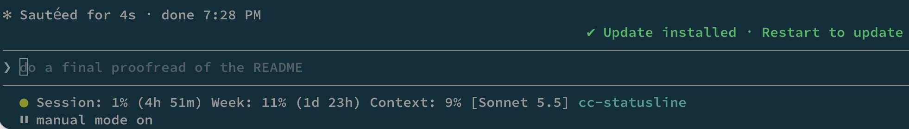
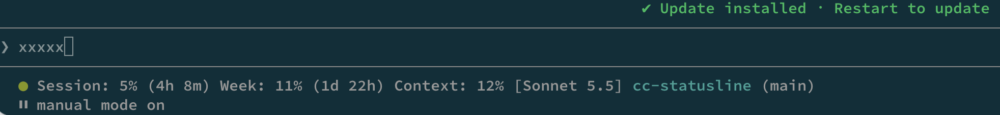
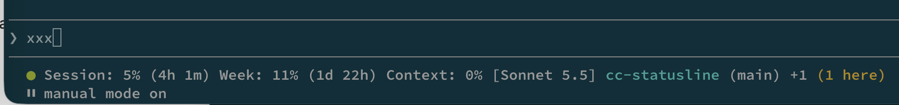
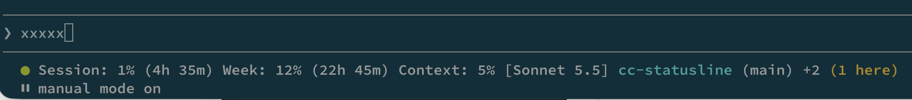

# Table Of Contents
- [Introduction](#introduction)
- [Screenshots](#screenshots)
- [Requirements](#requirements)
- [Install](#install)
- [Description](#description)
- [Troubleshooting](#troubleshooting)
- [Uninstall](#uninstall)
- [License (MIT)](#license-mit)
- [Credits](#credits)

# Introduction

**cc-statusline** is a bash script to show usage and other info in the
[Claude Code](https://code.claude.com/docs/en/statusline) status line.

It shows how much of the 5-hour and weekly limits you have used, how much
of the context window is used, the model, working directory, git branch
and how many other Claude Code sessions are running.

I like to see this info at a glance so I don't have to type `/usage` or
`/context` all the time. Hope you will find it useful as well.

# Screenshots

Here is what it looks like on my Mac in [iTerm2](https://iterm2.com/).



*Screenshot: Outside a git repo*

The directory is not a git repo, so only the working directory is shown.



*Screenshot: Inside a git repo*

In a git repo, the branch is shown after the directory name, here `(main)`.



*Screenshot: `+1` = one other session is running on this machine, `(1 here)` = that session is in the same repo as this one*



*Screenshot: `+2` = two other sessions on this machine, `(1 here)` = one of those two is in this repo (this session is not counted)*

# Requirements

* bash
* [jq](https://jqlang.org/)
* `ps` (comes with macOS and Linux, used to find the Claude Code process)
* git (optional, used to find the branch and count sessions in the same repo)
* A terminal that supports ANSI colors

I tested it on macOS and Linux. For Windows, try [WSL](https://learn.microsoft.com/en-us/windows/wsl/) (untested).

# Install

To install the script, run these commands.

```bash
git clone https://github.com/muquit/cc-statusline.git
cd cc-statusline
mkdir -p ~/.claude
cp statusline-command.sh ~/.claude/
chmod +x ~/.claude/statusline-command.sh
```

Add the following to `~/.claude/settings.json`.

```json
"statusLine": {
  "type": "command",
  "command": "~/.claude/statusline-command.sh"
}
```

If the status line does not show up in a session that is already running, restart
Claude Code.

Here is what my `~/.claude/settings.json` looks like.

```json
{
  "statusLine": {
    "type": "command",
    "command": "~/.claude/statusline-command.sh"
  },
  "enabledPlugins": {
    "gopls-lsp@claude-plugins-official": true,
    "swift-lsp@claude-plugins-official": true
  },
  "theme": "dark",
  "model": "sonnet"
}
```

# Description


In the screenshot above, I have used 1% of the 5-hour limit and 11% of the
weekly limit. They reset in 4h 51m and 1d 23h, respectively. The dot is green
and the context window is 9% used. I am using Sonnet 5.5 in `cc-statusline`.
The branch is hidden because I haven't made this directory a git repo yet.
I only have one Claude Code session running, so `+N` is hidden too.

| Part | Meaning |
|------|---------|
| `●` | Color based on the higher of the session and week percentages (green below 50%, yellow at 50–79%, red at 80% or above) |
| `Session: 1% (4h 51m)` | 5-hour limit used, and time until it resets (`--` if not reported yet) |
| `Week: 11% (1d 23h)` | 7-day limit used and time until it resets (hidden until reported) |
| `Context: 9%` | context window used in this session (0% until the first response, and right after `/clear` or `/compact`) |
| `[Sonnet 5.5]` | current model |
| `cc-statusline` | working directory (last component by default) |
| `(main)` | git branch or short commit hash if HEAD is detached (hidden outside a repo) |
| `+2` | Number of other Claude Code sessions running on this machine, in any directory or repo. This session is not counted (hidden when zero) |
| `(1 here)` | How many of those are in the same git repo, or the same directory if there is no repo, shown in yellow (hidden when zero). `+2` without it means the other sessions are working somewhere else |

`Session` and `Week` are the same as **Current session** and **This week**
under **Settings > Usage** in the Claude desktop app. These limits are for
your whole account. All your Claude Code terminals and the desktop app
share them.

**NOTE** Claude Code sends rate limit data only for claude.ai Pro and Max
subscribers, and only after the first response in a session. You will see
`Session: 0% (--)` when you first start a session.

The script reads JSON from Claude Code on stdin and runs `git` and `ps`
locally. It makes no network calls.

To count other sessions, the script writes one small file per session in
`~/.claude/live-sessions/`. Each file contains the Claude Code process ID,
the repo root (or directory) and the working directory. The script removes
the files for sessions that have exited. This is the only directory it writes to.

To see which sessions are running on this machine (for example, the three
behind the `+2 (1 here)` screenshot):

```
for p in $(pgrep -x claude); do
  echo "$p $(ps -o tty=,etime= -p $p) $(lsof -a -p $p -d cwd -Fn | sed -n 's/^n//p')"
done
```

Output:

```
44726 ttys005  39:48 /Users/muquit/gitdev/cc-statusline
51634 ttys007  15:19 /Users/muquit/gitdev/cc-statusline
55442 ttys003  00:06 /Users/muquit/gitdev/twofa-rescue
```

# Troubleshooting

If you see a problem with the status line, ask Claude Code to look at
`statusline-command.sh`, fix it, and send a pull request. Thx

# Uninstall

Remove the `statusLine` key from `~/.claude/settings.json`. Then run the
following commands to remove the script and the session files.

```bash
rm ~/.claude/statusline-command.sh
rm -rf ~/.claude/live-sessions
```

# License (MIT)

License is MIT. Please see [LICENSE.txt](LICENSE.txt) for details.

# Credits

* [Claude](https://claude.ai) on the web with Claude Opus 5.5 to develop the script.

* [Claude Code](https://claude.com/claude-code) with Claude Sonnet 5.5 to clean it up.


---
<sub>TOC/glossary expansion by https://github.com/muquit/markdown-toc-go v1.0.6 on Nov-24-2026</sub>
